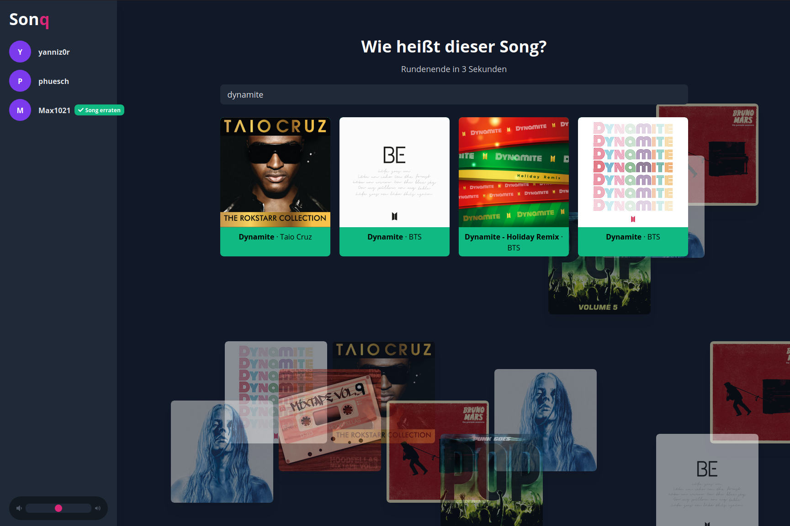
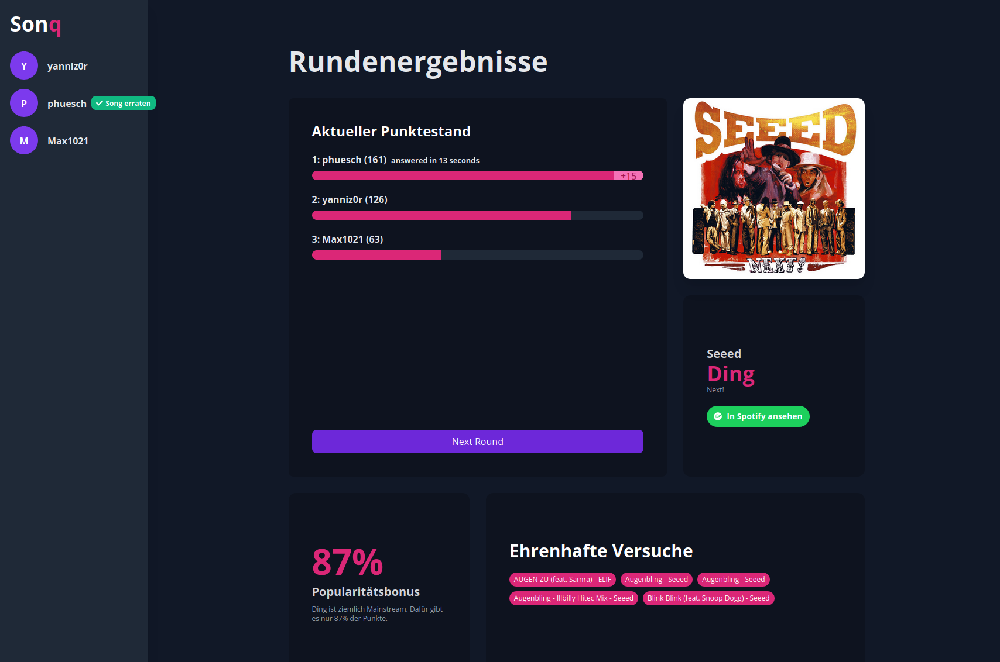

# Sonq

> A multiplayer song guessing game: everyone hears the same 30-second preview, first to find the song wins the most points.





## Status

Sonq is being rewritten. The old Spotify-based version stopped working (Spotify dropped preview URLs) and now lives in [legacy/](./legacy/). The new version uses Deezer previews, TanStack Start and Server-Sent Events in a Turbo + Bun monorepo. See [docs/plan.md](./docs/plan.md) for the roadmap and game design.

## Development

Requires [Bun](https://bun.sh).

```sh
bun install
bun run dev
```

No API keys needed: Deezer's public API works without authentication.

## Props

This game has been developed live on twitch [by me](https://www.twitch.tv/yanniz0r) and my viewers. Thanks for the great support, issues and input. This would not have been possible without you
❤️.
